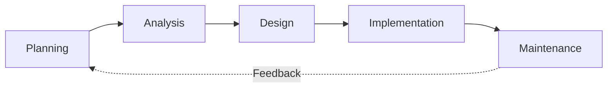

# محیط توسعه سیستم‌ها

[بازگشت به معرفی](../README.md)

پروژه DASS — تحلیل دانشگاهی

## ۱-۱. نقش تحلیلگر
تحلیلگر مشکلات رزرو دستی، قواعد ظرفیت، نیازهای مشتری و جداسازی داده کسب‌وکارها را بررسی می‌کند. پروژه دانشگاهی انفرادی است؛ تیم توسعه واقعی فرضی است.

## ۱-۲. چرخه حیات SDLC
| مرحله | خروجی DASS |
|---|---|
| برنامه‌ریزی | محدوده، منشور، امکان‌سنجی |
| تحلیل | نیازمندی‌ها و DFD |
| طراحی | مشخصات منطقی و فیزیکی پیشنهادی |
| پیاده‌سازی | توسعه و آزمون فرضی |
| نگهداری | اصلاح و بهبود فرضی |

فقط مستندات فصل‌های ۱ تا ۷ تحویل می‌شوند.

## ۱-۳. آبشاری و چابک
آبشاری برای کنترل اسناد و نقاط تصمیم مناسب است، ولی کشف دیرهنگام نیاز به ظرفیت چندگانه موجب بازکاری می‌شود. مدل مفهومی هزینه تغییر C(t)=C₀e^(kt) است؛ ضریب واقعی در دسترس نیست. چابک برای تغییر قواعد خدمات مناسب‌تر است.

## ۱-۴. ارزش‌های چابک
تعامل با ذی‌نفعان، بازخورد روی نمونه مفهومی، همکاری مشتری و پاسخ به تغییرات به جای تثبیت زودهنگام همه قواعد. مستندات همچنان محصول اصلی درس هستند.

## ۱-۵. Scrum و XP
| بک‌لاگ | قابلیت | اولویت |
|---|---|---|
| PB01 | حساب، کسب‌وکار، تأیید و صفحه عمومی | بالا |
| PB02 | شعب، کارکنان، خدمات و فرم | بالا |
| PB03 | ساعات، ظرفیت، مدت، تعطیلات و تداخل | بالا |
| PB04 | جست‌وجو و رزرو و تأیید | بالا |
| PB05 | لغو، تغییر، سابقه و پیامک | بالا |
| PB06 | پرداخت و اشتراک | بالا |
| PB07 | نظر، شکایت، گزارش و مدیریت | متوسط |

در توسعه فرضی مالک محصول اولویت می‌دهد، اسکرام مستر تسهیل می‌کند و توسعه‌دهندگان افزونه تحویل می‌دهند. اسپرینت پیشنهادی دو هفته با برنامه‌ریزی، جلسه روزانه، بازبینی و بازنگری است. XP شامل بازبینی دونفره منطق ظرفیت، TDD برای رزرو هم‌زمان، بازآرایی و مشارکت مشتری است. هیچ آزمون اجرایی انجام نشده است.

## ۱-۶. بوهم و ترنر
| محور | ارزیابی فرضی | گرایش |
|---|---|---|
| اندازه | تیم کوچک | چابک |
| بحرانی بودن | خسارت مالی و عملیاتی در پرداخت و رزرو | برنامه‌محور در بخش حساس |
| پویایی | تنوع قواعد مشاغل | چابک |
| مهارت | نامعلوم | نیازمند ارزیابی |
| فرهنگ | اسناد رسمی و بازخورد | ترکیبی |

## ۱-۷. انتخاب
روش Hybrid: SDLC برای کنترل رسمی و Agile برای پالایش نیازها؛ Scrum و XP در توسعه فرضی. کنترل ظرفیت و محرمانگی بر سرعت اولویت دارند. تعهد تدریجی در پایان هر مرحله اعمال می‌شود.

منبع: جزوه، صفحات ۹–۱۶. همه فرضیات و اولویت‌ها پیشنهادی‌اند.