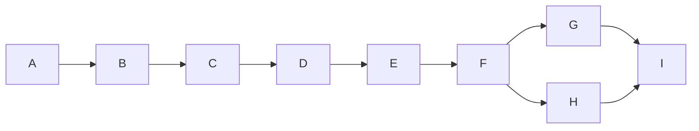

# فصل سوم: مدیریت پروژه سیستم‌های اطلاعاتی

[بازگشت](../README.md) — مبنا: صفحات ۲۵ تا ۳۳ جزوه

## محدودیت سه‌گانه
محدوده: هفت فصل مستندات، بدون کد اجرایی. زمان: ۱۲ روز کاری فرضی برای مستندسازی. هزینه: ۴۸ ساعت کار دانشجو با ارزش فرضی ساعتی ۱۵۰ هزار تومان، معادل ۷٫۲ میلیون تومان هزینه فرصت؛ پرداخت نقدی واقعی ادعا نمی‌شود. تغییر محدوده باید با زمان و هزینه دوباره سنجیده شود.

## درخواست خدمات سیستم (SSR)
| فیلد | شرح |
|---|---|
| درخواست‌کننده | نماینده فرضی کسب‌وکارهای خدماتی |
| مسئله | ثبت پراکنده و تداخل نوبت‌ها |
| درخواست | سامانه متمرکز با قواعد قابل تنظیم |
| منفعت | کاهش خطا و زمان هماهنگی، دسترسی مشتری |
| اولویت | بالا، مشروط به امکان‌سنجی |
| تأیید | پیشنهادی؛ تأیید واقعی اخذ نشده |

## منشور پروژه
هدف: تهیه تحلیل و مدل فرایندی DASS؛ مدیر پروژه دانشگاهی: دانشجو؛ حامی فرضی پروژه واقعی: مالک محصول. معیار تحویل: پوشش هفت فصل، سازگاری محاسبات و موازنه DFD. محدودیت: عدم پیاده‌سازی. ریسک: تغییر محدوده، نبود داده میدانی و خطای مدل‌سازی.

## مراحل مدیریت پروژه
آغاز: SSR و منشور؛ برنامه‌ریزی: WBS، زمان و منابع، BPP و ارتباطات؛ اجرا: تهیه مستندات و کنترل تغییر؛ خاتمه: بررسی نهایی، ثبت درس‌آموخته‌ها و تحویل مخزن. پذیرش استاد هنوز انجام نشده است.

## WBS و PERT
مدت‌ها روز کاری فرضی‌اند. ET=(o+4r+p)/6؛ هر روز ۴ ساعت. وابستگی‌ها برای برنامه مستندسازی هستند، نه ساخت محصول.

| ID | بسته کاری | پیش‌نیاز | o | r | p | ET |
|---|---|---|---:|---:|---:|---:|
| A | فصل ۱ و محدوده | — | 1 | 1 | 1 | 1 |
| B | فصل ۲، منابع | A | 1 | 1 | 1 | 1 |
| C | فصل ۳، مدیریت | B | 1 | 1 | 1 | 1 |
| D | فصل ۴، انتخاب | C | 1 | 1 | 1 | 1 |
| E | فصل ۵، امکان‌سنجی | D | 1 | 2 | 3 | 2 |
| F | فصل ۶، نیازمندی | E | 1 | 2 | 3 | 2 |
| G | فصل ۷، مدل فرایند | F | 2 | 3 | 4 | 3 |
| H | بازبینی نگارشی | F | 1 | 1 | 1 | 1 |
| I | بازبینی نهایی | G,H | 1 | 1 | 1 | 1 |

H در بازه G قرار دارد؛ چون پروژه انفرادی است، ظرفیت روزانه ۴ ساعت برای مسیر اصلی و زمان اضافی برای H نیاز است، یا H باید در برنامه تسطیح منابع به ۱۳ روز منتقل شود. هزینه فرصت ۴۸ ساعت مربوط به مسیر اصلی است؛ با H مجموع ۵۲ ساعت و ۷٫۸ میلیون تومان است. برنامه مبنا پس از تسطیح، ۱۳ روز و ۵۲ ساعت است.

## نمودار شبکه

## CPM پیش از تسطیح منابع
EF=ES+ET؛ ES بیشینه EF پیش‌نیازها؛ LS=LF-ET؛ LF کمینه LS جانشین‌ها؛ Slack=LS-ES.

| ID | ES | EF | LS | LF | Slack |
|---|---:|---:|---:|---:|---:|---:|
| A | 0 | 1 | 0 | 1 | 0 |
| B | 1 | 2 | 1 | 2 | 0 |
| C | 2 | 3 | 2 | 3 | 0 |
| D | 3 | 4 | 3 | 4 | 0 |
| E | 4 | 6 | 4 | 6 | 0 |
| F | 6 | 8 | 6 | 8 | 0 |
| G | 8 | 11 | 8 | 11 | 0 |
| H | 8 | 9 | 10 | 11 | 2 |
| I | 11 | 12 | 11 | 12 | 0 |

مسیر بحرانی A-B-C-D-E-F-G-I برابر ۱۲ روز است؛ برنامه فردی تسطیح‌شده ۱۳ روز.

## گانت برنامه مبنا (روز کاری)
| فعالیت | شروع | پایان |
|---|---:|---:|
| A | 1 | 1 |
| B | 2 | 2 |
| C | 3 | 3 |
| D | 4 | 4 |
| E | 5 | 6 |
| F | 7 | 8 |
| G | 9 | 11 |
| H | 12 | 12 |
| I | 13 | 13 |

## کنترل پروژه
ثبت تغییرات در GitHub، بازبینی هر فصل و مقایسه با محدوده مصوب. در صورت تأخیر از حذف کنترل ظرفیت یا موازنه DFD اجتناب می‌شود؛ کاهش محدوده فقط با تأیید. افزایش نیروی دیرهنگام در پروژه واقعی ممکن است طبق قانون بروکس سربار ایجاد کند. همه زمان‌ها برنامه فرضی‌اند، نه گزارش عملکرد واقعی.
