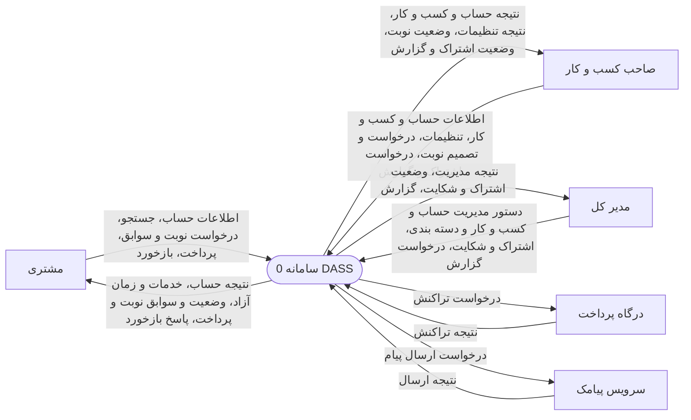
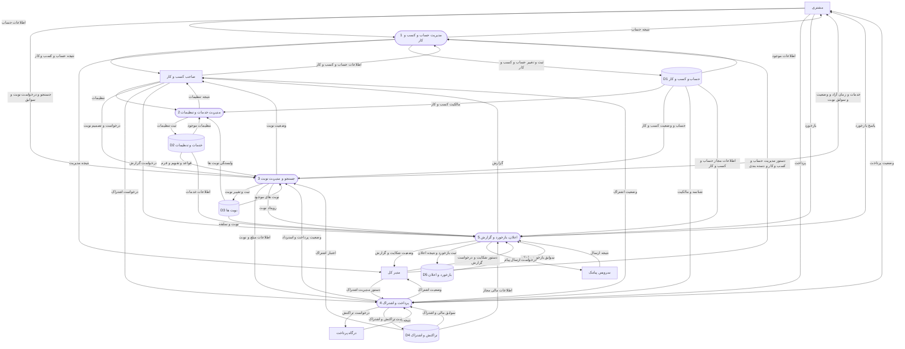
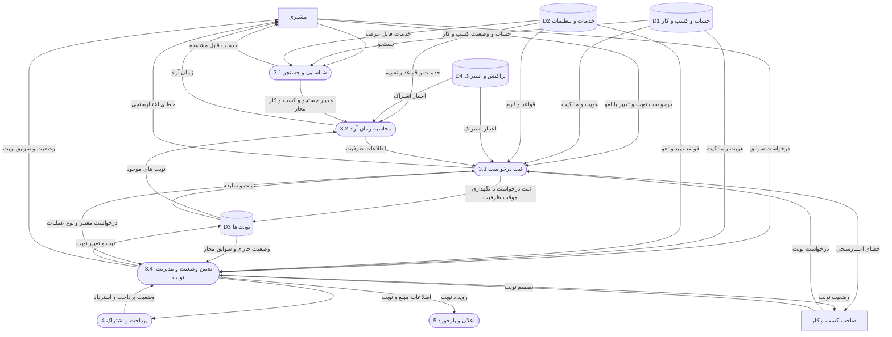
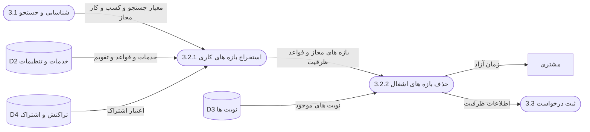
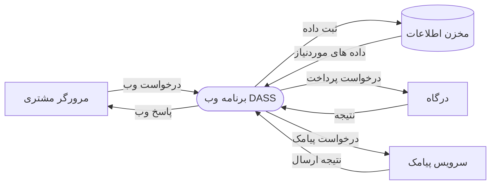
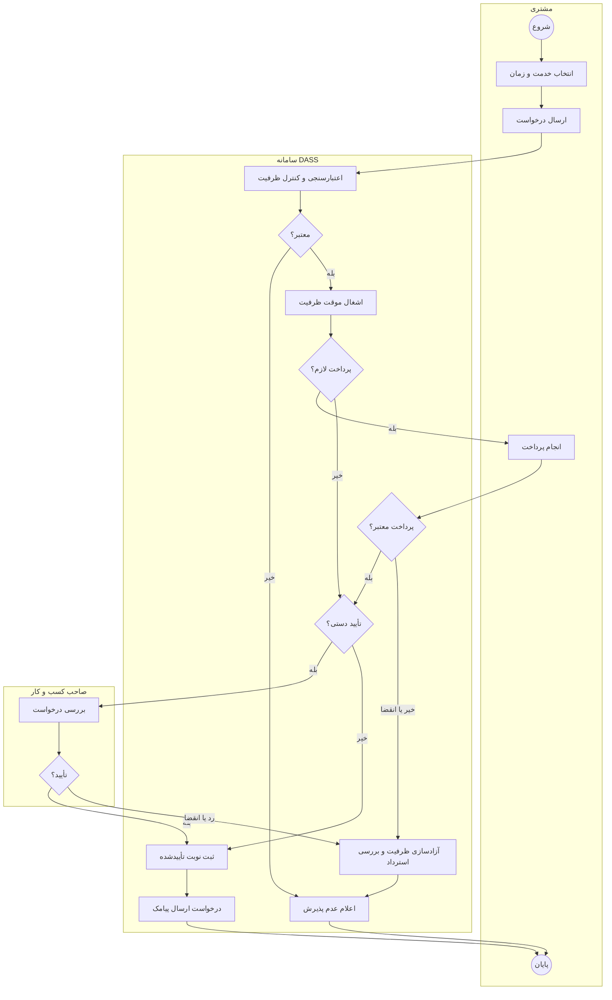

# ساختاردهی به نیازمندی‌های فرایندی سیستم

[بازگشت](../README.md)

## ۷-۱. عناصر DFD
موجودیت خارجی با مستطیل، فرایند با مستطیل گرد، انبار داده با شکل استوانه‌ای (تقریب نمایشی در Mermaid) و جریان داده با پیکان نام‌دار نشان داده می‌شود. شماره فرایند شناسه تجزیه است نه ترتیب اجرا. DFD جریان اطلاعات را نشان می‌دهد، نه ترتیب زمانی فعالیت‌ها.

## نمودار بستر (Context Diagram)


کارکنان در این نسخه کاربر مستقل نیستند. درگاه و پیامک بیرون از مرز سامانه‌اند. اعلان به مشتری توسط سرویس پیامک تحویل می‌شود.

## نمودار سطح صفر (Level-0 DFD)


## ۷-۲. قواعد مکانیکی
اتصال مستقیم موجودیت خارجی به انبار، انبار به انبار یا موجودیت خارجی به موجودیت خارجی در DFD سامانه مجاز نیست. هر فرایند ورودی و خروجی مرتبط دارد. سیاه‌چاله: ورودی بدون خروجی؛ معجزه: خروجی بدون ورودی؛ حفره خاکستری: ورودی ناکافی برای خروجی. کنترل ظرفیت نیازمند تقویم، مدت، منابع و نوبت‌های موجود است؛ صرفاً تاریخ درخواستی کافی نیست.

## ۷-۳. تجزیه فرایند 3 به سطح یک


### موازنه (Balancing)
| رابط فرایند 3 در سطح صفر | زیر فرایند سطح یک |
|---|---|
| جستجو و درخواست نوبت و سوابق مشتری | 3.1 و 3.3 و 3.4 |
| خدمات و زمان آزاد و وضعیت و سوابق نوبت مشتری | 3.1 و 3.2 و 3.3 و 3.4 |
| درخواست و تصمیم صاحب کسب و کار | 3.3 و 3.4 |
| وضعیت نوبت صاحب کسب و کار | 3.3 و 3.4 |
| خواندن D1,D2,D3,D4 | 3.1 تا 3.4 مطابق نمودار |
| ثبت و تغییر D3 | 3.3 و 3.4 |
| ارتباط مالی دوطرفه با 4 | 3.4 |
| رویداد نوبت به 5 | 3.4 |

خطای اعتبارسنجی بخشی از وضعیت درخواست است، نه جریان جدید خارجی. در سطح صفر نیز مجموع جریان‌های هر موجودیت با نمودار بستر تطبیق دارد؛ جریان‌های داخلی در نمودار بستر نمایش داده نمی‌شوند.

### تجزیه نمونه 3.2 تا سطح ابتدایی

ورودی و خروجی سطح پایین با 3.2 موازنه شده است.

## ۷-۴. چهار نوع DFD
| نوع | مدل DASS |
|---|---|
| Current Physical | مشتری تلفنی با پذیرش تماس می‌گیرد؛ پذیرش دفتر کاغذی را می‌خواند و تغییر می‌دهد (فرضی) |
| Current Logical | دریافت درخواست، بررسی برنامه، ثبت نوبت، اطلاع نتیجه |
| New Logical | دریافت درخواست، محاسبه ظرفیت از قواعد، نگهداری موقت، تأیید مالی و مدیریتی، ثبت و اعلان |
| New Physical | مرورگر، برنامه وب، مخزن اطلاعات و رابط سرویس پرداخت و پیامک؛ صرفاً نمای پیشنهادی |


نمای فیزیکی موجود فرضی است.

نمای منطقی موجود.

نمای فیزیکی مطلوب مفهومی؛ نمای منطقی مطلوب در سطح صفر آمده است.

## ۷-۵. انگلیسی ساختاریافته (Structured English)
شرح منطقی رزرو، نه کد اجرایی:

```text
IF account and business are eligible AND form is complete
    IF interval fits calendar AND capacity is available
        HOLD capacity for the configured period
        IF payment is required
            REQUEST verified payment
        ENDIF
        IF payment is not required OR verified payment is successful
            IF manual approval is required
                SET status to pending approval
            ELSE
                CONFIRM appointment
            ENDIF
        ELSE
            WAIT until payment deadline; release capacity on expiry
        ENDIF
    ELSE
        RETURN unavailable
    ENDIF
ELSE
    RETURN validation error
ENDIF
```
پرداخت ناموفق قطعی، رد دستی یا انقضا موجب آزادسازی ظرفیت و بررسی استرداد در صورت وجود پرداخت می‌شود. مدت مهلت باید اعتبارسنجی شود.

### جدول تصمیم رزرو اولیه
شرط A: صلاحیت حساب و کسب و کار و فرم معتبر؛ B: ظرفیت و زمان معتبر؛ C: پرداخت لازم است؛ D: تأیید دستی لازم است. چهار شرط دودویی در حالت کامل ۱۶ ترکیب دارند؛ علامت — یعنی بی‌تفاوتی. جدول فشرده تمام ترکیب‌ها را پوشش می‌دهد.

| شرط یا اقدام | R1 | R2 | R3 | R4 | R5 | R6 |
|---|---|---|---|---|---|---|
| A | خیر | بله | بله | بله | بله | بله |
| B | — | خیر | بله | بله | بله | بله |
| C | — | — | بله | بله | خیر | خیر |
| D | — | — | بله | خیر | بله | خیر |
| رد اعتبارسنجی | X | | | | | |
| رد ظرفیت | | X | | | | |
| نگهداری موقت و انتظار پرداخت | | | X | X | | |
| انتظار تأیید پس از پرداخت موفق | | | X | | | |
| تأیید پس از پرداخت موفق | | | | X | | |
| انتظار تأیید بدون پرداخت | | | | | X | |
| تأیید مستقیم | | | | | | X |

رد اعتبارسنجی ۸، رد ظرفیت ۴ و چهار حالت دیگر هرکدام یک ترکیب را پوشش می‌دهند؛ جمع ۱۶.

## مدل فرایند کسب و کار BPMN
نمای مفهومی با رویداد شروع/پایان، فعالیت، دروازه XOR و خطوط شناوری؛ Mermaid تقریب بصری BPMN است و فایل استاندارد BPMN XML محسوب نمی‌شود.



## ۷-۶. کنترل کیفیت و ردیابی
| فرایند | شناسه نیازمندی |
|---|---|
| 1 | FR01,02,15,24,25,26 |
| 2 | FR03–10,13 |
| 3 | FR11–14,16–20 |
| 4 | FR22,29 |
| 5 | FR21,23,27,28 |

بازبینی منطقی: هیچ ارتباط مستقیم موجودیت و انبار یا دو انبار وجود ندارد؛ ورودی محاسبه ظرفیت کافی است؛ جریان‌های مرزی تجزیه 3 و 3.2 بررسی شده‌اند. عمق تجزیه برای فرایند محاسبه زمان آزاد نمونه‌سازی شده است؛ سایر فرایندها تا سطح صفر باقی مانده‌اند. مدل‌ها نیازمند اعتبارسنجی ذی‌نفعان‌اند و نمودارهای Mermaid جایگزین کامل نمادگذاری رسمی Gane & Sarson یا BPMN نیستند.
